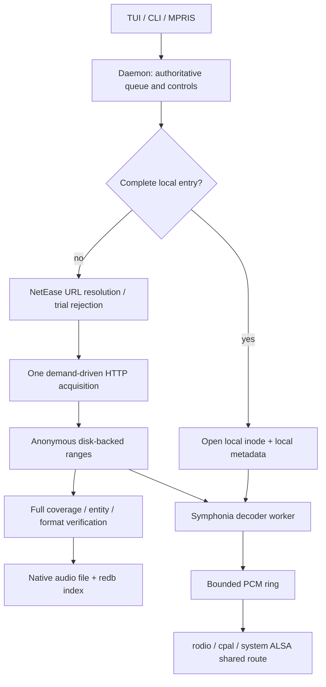

# Architecture

## Crates and ownership

| Crate | Responsibility |
|---|---|
| `yoruplay-protocol` | Shared models, strict typed config, XDG inventory, versioned IPC. |
| `yoruplay-api` | NetEase HTTP/crypto/session and bounded typed large responses. |
| `yoruplay-ipc` | Bounded Unix-socket client; request ownership and cancellation. |
| `yoruplay-core` | Queue, Rust audio engine, shared transfer, audio/metadata caches, persistence, server and MPRIS. |
| `yoruplay-tui` | Paged Ratatui browser and controls; no direct media/network backend. |
| `yoruplay` | CLI dispatch, config/path management, diagnostics and daemon lifecycle. |

No mpv process, socket, backend alias or runtime dependency remains. Audio output
opens lazily and uses the system's shared PipeWire/Pulse ALSA route where
available. Explicit device selection does not silently fall back to unrelated
hardware. Stop releases the decoder, output and source; closing the TUI does not.

The decoder worker owns blocking demux/decode. The realtime Source consumes only
the bounded SPSC PCM ring: no HTTP, filesystem read, decoder or tag operation runs
inside the output callback. Symphonia packet/error APIs distinguish decode/I/O
failure from ordinary EOF. Rodio supplies output mixing/conversion, not a second
downloader. The API and transfer share reqwest 0.12; core and rodio share
Symphonia 0.5.5.

## Source lifecycle and retries

- A complete cache lookup happens before stream resolution, regardless of the
  configured quality. Local playback retains the original inode/pin through
  device recovery, seeks and pauses; it never resolves a replacement URL.
- Source/load generations and an audio-source token discard stale results. An
  error arriving before the Playing-state commit is retained, not lost.
- Short accepted control transactions are daemon-owned and bounded. Eight normal
  slots and two independent urgent slots keep Stop/Next out of browse backlogs.
  Slow API preparation and retry sleeps do not hold the playback lock.
- One atomic retry budget covers API, CDN and device recovery for a source:
  initially three retries, ten seconds apart. These are retries **after** the
  initial attempt. Stop/Next/shutdown cancels waits. Nontransient authorization,
  unsupported/corrupt audio and trial restrictions are not network retries.
- A CDN retry resumes verified missing ranges on the same anonymous inode. URL
  refresh must preserve the object identity. Nested retry loops cannot reset or
  multiply the remaining budget.
- Source changes cancel producers, wake reads, join decoder/output and release
  incomplete anonymous storage before acknowledgement. Explicit upgrades have
  their own owner cancellation and completion acknowledgement.

## Zero-network local boundary

Daemon startup reads saved account state but does not validate it online. TUI
startup does not automatically fetch daily recommendations. Local audio uses
stored lyrics/artwork only; MPRIS publishes local file artwork, not a remote URL.
A missing cached lyric/cover stays missing. Device reopen is local.

Local-only queues reject a missing entry rather than downloading it. Actual local
sources do not automatically replenish FM or Heartbeat over the network. Explicit
online browsing and explicit CLI quality upgrades remain deliberate network
operations. A later uncached item in an ordinary online queue may use the network.
Trial `freeTrialInfo` is rejected before a media GET, with bounded unique-ID
traversal so repeat modes cannot spin indefinitely.

## Queue and IPC

The canonical queue is an `Arc<Vec<QueueItem>>` with copy-on-write mutations and a
content revision. Snapshot pages clone at most 100 items; cursor/scalar updates do
not clone the entire queue. Shuffle selects a random rank outside its small
exclusion set without allocating an O(queue-size) candidate vector.

| Mode | Automatic end | Manual Next / Previous |
|---|---|---|
| List repeat | Wrap | Queue order / history |
| Track repeat | Rewind the current source | Move track / history |
| Sequential | Stop at final item | Queue order / history |
| Shuffle | Bounded recency exclusion | Random next / playback history |
| Heartbeat | Contextual recommendation, unless local | Contextual next / history |

IPC version 5 is newline-delimited JSON with a 4 MiB frame cap. Hello negotiates
the exact version. Requests have IDs; responses carry typed results or stable
error code/message/hint. `Cancel { id }`, disconnect and superseded TUI browsing
release owned request work. The TUI aborts stale browse tasks and rejects stale
responses using a content generation.

`QueueChanged { revision }` replaces repeated full queue events. GetQueue pages
and GetPlayback scalar snapshots allow independent resynchronization. Playlist
page selection sends the selected song ID, not a page-relative index that can
shift when unavailable details are filtered.

Notification backlog does not tear down a healthy RPC connection. A single
forwarder waits under the existing byte/count budgets; broadcast lag replaces
the subscription and resynchronizes authoritative playback, queue revision and
auth state. A three-second socket-write deadline disconnects genuinely stalled
peers so they cannot retain the global outbound budget indefinitely.

Server admission and outbound queues have both count and byte bounds. Urgent
controls have independent admission. Slow clients coalesce/drop notifications or
are disconnected rather than retaining arbitrarily many serialized queue
snapshots. The client limits normal/urgent in-flight requests independently.

## Persistence and caches

- Compact `state.json` stores cursor, mode, volume, position, source and a queue
  revision; `queue-<revision>.json` stores the shared queue. Streaming atomic
  writes publish the queue first, state reference second, then remove obsolete
  snapshots. Valid startup state removes unreferenced crash leftovers before a
  revision can be reused. V1 inline queues migrate locally. Restored queues start
  stopped. Corrupt state is quarantined rather than silently overwritten.
- `auth.json` stores the session/device identity with mode 0600; never logged.
- `metadata/` holds TTL JSON responses, independently bounded by `cache.max_mb`
  (32 MiB default). Legacy recognized JSON cache files migrate locally. Logs are
  never metadata-cache eviction candidates.
- `audio/` holds complete native-format audio, manifests, bounded optional local
  artwork and redb 2.4.0 with an explicit 1 MiB page cache. An ordered completion
  index provides FIFO eviction; local playback does not refresh age.
- Audio budget defaults to 10 GiB. Pins, reservations, artwork, scratch and
  over-budget state are reported honestly. Pins can delay quota trimming; release
  immediately retries it. Oversize/nonretained playback uses a bounded anonymous
  disk window, not a whole-track RAM buffer.
- Staging uses Linux `O_TMPFILE` and unprivileged link publication on the cache
  filesystem. No named `.part` exists, including after SIGKILL. Full coverage,
  normal transfer termination, identity and native-format verification precede
  tag writing/publication. Metadata rewrite is bounded and waits for readers.
- Explicit audio clear cancels upgrades, invalidates in-flight retention and
  unlinks complete records/files. Existing pinned readers continue through their
  open inode, with bytes accounted until release; no late transfer can republish
  a cleared entry. Quota eviction, unlike explicit clear, skips pins.

## Configuration, paths and MPRIS

Config setters lock read/modify/rename, preserve comments and reject unknown or
invalid values without overwriting the old file. `config list/get` expose units,
allowed values and apply policy. A successful disk write is distinct from a
successful daemon reload. Audio directory/API timeout/log changes require daemon
restart; source buffers/retries affect the next source. `listpath` inventories
configured and active paths without creating them.

The daemon alone owns `org.mpris.MediaPlayer2.yoruplay`. Properties come from
scalar playback state, not full queue snapshots. Metadata includes a stable
`/org/yoruplay/track/<id>`, microsecond duration/position, artist arrays and plain
lyrics. SetPosition checks the track ID. Loop/shuffle approximate the internal
modes; Heartbeat remains selectable through TUI/CLI.

API, output, MPRIS registration and client failures are isolated. A failed lyric
fetch does not stop audio; an unplayable source reports an error without exiting
the daemon. See [audio/cache design](song-cache.md) and
[measured resource report](resource-usage.md) for policy and exercised limits.
