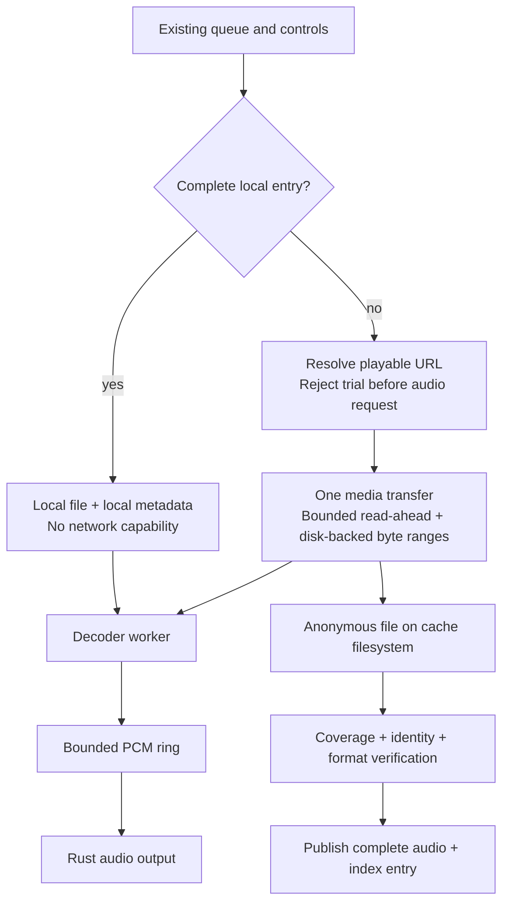

# Rust playback and audio-cache design

Status: implemented Rust playback/audio-cache cutover. This replaces the old
mpv + independent downloader proposal and unlimited-cache policy; there is no
remaining mpv runtime backend. See [pigma analysis](pigma-playback-analysis.md)
for reference-source findings and [resource report](resource-usage.md) for
measured acceptance evidence, distinct from design targets below.

## 1. Required behavior

- Remove mpv completely; one Rust playback backend, not two selectable backends.
- Cache the bytes acquired by playback itself. No second audio download, no
  background completion after a track is abandoned, no next-track prefetch.
- Only a complete, verified, non-trial audio object becomes an offline entry.
- Prefer an existing complete entry even after `api.quality` changes. Upgrade is
  an explicit CLI operation, never an implicit consequence of a cache hit.
- A selected local source performs no network operations, including account
  validation, lyrics, artwork, URL refresh and automatic recommendations.
- Default audio budget: 10 GiB. CLI/config use the spelling G; 1G = 1024^3 bytes.
  Evict oldest completed entries first, not least-recently-played entries.
- No named audio `.part` files. Cancelled/incomplete data must be released now,
  including on process death, not swept on the next launch.
- Prefer Rust libraries for downloading, decoding, metadata and indexing. OS
  audio drivers and filesystem syscalls remain platform dependencies.
- Preserve daemon/TUI separation, existing queue modes, controls and MPRIS.
- Low memory is a measured acceptance criterion, not a benefit assumed from Rust.

## 2. Playback architecture



### Components and ownership

- Borrow pigma's separation of source resolution, disk-backed transport, decoder
  and audio output. Do not copy its TUI, cover decoder, EQ, WSOLA or third-party
  fallback machinery: these are not current YoruPlay requirements.
- Selected decoder/output baseline: rodio 0.22.2 with Symphonia and cpal.
  The declared Rust minimum is 1.87, checked against the committed lockfile.
  Resolver 3 keeps transitive dependencies MSRV-compatible. Enabled complete
  codec/container pairs include Ogg/Vorbis and WAV/PCM.
  Decode on a dedicated worker into a bounded PCM ring; only the ring-backed
  Source reaches output. Never append a blocking-reader Decoder directly.
  Linux cpal still depends on system ALSA and its PipeWire/Pulse device routing;
  “prefer Rust” does not mean shipping a Rust kernel/audio driver.
- Use one concrete AudioEngine in core, not an extensible backend/plugin trait.
  Its input is a local handle or a shared transfer reader, never a URL that the
  decoder/output layer downloads independently.
- One media transfer at a time. Normal playback and explicit upgrades share the
  same coordinator. Network playback has priority over an upgrade; an interrupted
  upgrade reports cancellation and preserves its old cache entry.
- Bounded command channels; coalesce superseded seek/load commands. Every source,
  decoder event, download and metadata task carries a load generation.
- Source changes cancel the old transfer, wake blocked reads, release old readers
  and await cancellation. Stop/shutdown acknowledges after incomplete handles are
  closed. No detached task may retain an anonymous file after cancellation.
- Output opens lazily. Stop releases the device, decoder and transfer resources;
  closing the TUI does not stop the daemon's audio. Reopen on the next Play.
- Prefer the system's shared PipeWire/Pulse-routed output over an exclusive
  hardware device. Device loss/reopen is a local engine event, never a reason
  to resolve a cached track online. Sample conversion and buffering are included
  in the backend compatibility/memory checks.

### Transfer behavior

There is one logical audio acquisition, not necessarily one HTTP request forever:
URL resolution is an API request; normal media playback is a CDN request. Seek,
redirect and bounded failure recovery can require subsequent requests. None is a
second downloader created for caching.

- Start the CDN GET without a preliminary HEAD/probe GET. Inspect initial bytes
  from the same response, and feed those bytes to the same storage/decoder.
- Use `Accept-Encoding: identity` for byte-addressed audio. Track Content-Length,
  Content-Range and a usable entity identity/validator.
- Initial targets: 256 KiB prebuffer, 512 KiB compressed read-ahead, 100 ms PCM.
  These are bounded targets, not claims about total process memory.
- Demand-driven transfer: stop reading the body when sufficiently ahead.
  Pause cancels the active HTTP body after bounded in-flight data, but retains
  the anonymous file, downloaded ranges and bounded PCM. Resume requests only
  missing bytes using validated ranges; it does not discard already downloaded
  audio or start a second downloader. Decoder container/seek-table reads count
  as demand, not speculative downloads.
- Seek within downloaded ranges reads disk. Seek to a missing range replaces the
  active request with a Range request; it does not add a parallel downloader.
  A server that cannot honor safe ranges uses sequential reading/waiting rather
  than pretending a sparse hole contains audio.
- Maintain exact downloaded-range coverage. Reaching EOF after a forward seek,
  file logical length and `downloaded_bytes == size` are individually insufficient
  proof of completeness. Do not fill skipped holes solely to create a cache.
- Reuse already available bytes. Reconnect/expired URLs must be identity-checked
  before combining ranges. Never join two different encodings into one file.
- One source-generation retry budget covers API resolution, device recovery and
  CDN continuation: three retries after the initial attempt, ten seconds apart
  by default. Both values are configurable. Each layer consumes the same atomic
  remaining count, so nested retry loops cannot multiply attempts.
- Retry transient network/timeouts and recoverable device failures only. Trial,
  explicit authorization denial, unsupported/encrypted media and corrupt local
  files do not become network retries. Stop/Next/shutdown cancels retry waits.
- Retain the current anonymous inode/ranges across CDN retries and URL refresh;
  refresh must verify the replacement object before combining bytes. Exhaustion
  reports an error, not another freshly reset outer retry loop.
- Implement a small demand-driven RangeFetcher with the existing reqwest 0.12
  stack and disk-range store. Do not adopt stream-download 0.24.4: its eager file
  transfer does not supply the required demand/pause semantics, and it would add
  reqwest 0.13 plus Rust 1.91. Borrow its storage separation, not its runtime.

## 3. Anonymous staging and complete publication

Use Linux `O_TMPFILE` on the destination cache filesystem, without `O_EXCL`.
Use Rust filesystem APIs/rustix; no ffmpeg, mpv or shell subprocess in runtime.

1. Create an unnamed, private file. Audio reads and writes use separate offsets;
   `File::try_clone` alone is not proof of independent seek positions. Prefer
   offset-based I/O for the shared range store.
2. Store only received bytes, maintaining exact coverage and reserved budget.
3. On early skip, stop, network/decode failure or cancelled upgrade, cancel all
   producers/readers and close every handle. The kernel reclaims unnamed data,
   including after SIGKILL. There is no visible `.part` to clean up later.
4. A candidate needs successful HTTP transfer, complete `[0, length)` coverage,
   consistent object identity, supported ordinary audio and matching size/hash
   when supplied by the API/CDN. Unknown total length needs trustworthy normal
   response termination; a failed connection is not normal EOF.
5. Rich tags must not rewrite a file beneath an active decoder. Verify raw audio
   first, release readers, then write bounded metadata using lofty. Publication
   may therefore wait until the current track releases its decoder. Failed tags
   must not destroy valid audio or an older complete entry.
6. Flush/sync the finished inode, link it to a final versioned audio name, sync
   the directory, then commit the index transaction. Ordinary users can publish
   through `/proc/self/fd/<fd>` + `linkat(AT_SYMLINK_FOLLOW)` without capabilities.
7. Only then retire an older version. A crash between file publication and index
   commit leaves a complete orphan, not a partial entry; local reconciliation can
   recover it without network. Reconciliation is not deferred `.part` cleanup.

Filesystem capability is checked when selecting a cache path. If it cannot
support anonymous staging and publication, report that explicitly and require a
supported cache directory; do not silently introduce named partials or RAM files.
The current repository filesystem passed an unprivileged create/write/link smoke;
this does not establish support for every user-selected filesystem.

### Storage layout and index

Default cache root is `$XDG_CACHE_HOME/yoruplay`, falling back to
`~/.cache/yoruplay`. Audio now belongs under a cache directory, not Music: automatic
FIFO deletion must never accidentally treat a user's music collection as disposable.

```text
cache-root/                           # ~/.cache/yoruplay
  metadata/                           # existing TTL JSON cache, 32 MiB default
  audio/<id> - <artist> - <title> [<actual-quality>]-<version>.<ext>
  artwork/<id>-<version>.<ext>        # optional, bounded, local MPRIS artwork
  meta/<id>-<version>.json            # per-entry recovery manifest
  index.redb                          # complete-entry metadata and age ordering
  cache.lock                          # cache ownership lock
  yoruplay.log                        # not cache data; never cache-clear/trimmed
  tui.log                             # not cache data; never cache-clear/trimmed
```

- Sanitize path separators/control characters and bound component lengths without
  losing the numeric ID. Version names permit upgrades without mutating a reader's
  old inode. The logical index has one preferred complete version per song ID.
- Use a small on-disk index, not a startup load of all songs, lyrics, covers or
  tags into HashMaps. Selected library: pure-Rust redb 2.4.0 with an explicitly
  bounded 1 MiB page cache (never its default implicitly).
- Index records: ID, local filename/version, actual quality/bitrate/container,
  size, completion timestamp, Song display metadata, optional local lyrics/art.
  An ordered `(completed_at, id)` table makes FIFO eviction incremental.
- Page cache list operations. No artwork decoding and no full file reads to list
  entries. Missing embedded lyrics remain missing offline; missing local artwork
  is fetched alone from the image CDN.
- Index/file publication cannot form one filesystem transaction. Startup/local
  reconciliation must handle complete orphan files and stale/missing index paths;
  never trust an index record alone as proof that audio exists.
- Preserve native containers: `.mp3`, `.flac`, `.m4a` for MP4, `.aac` for raw ADTS,
  and supported Ogg/WAV. Do not label arbitrary AAC as M4A or unknown data as MP3.
- Bounded text tags, original/translated lyrics and optional embedded pictures
  accompany native-format publication where the container supports them.
  Metadata limits are lyrics 128 KiB, artwork 2.5 MiB and tag serialization
  4 MiB; reuse fetched metadata. NetEase covers are requested at 1024×1024 via
  the image CDN's `?param=1024y1024` query. Whole-audio buffering is unacceptable;
  tag updates use a bounded disk rewrite.

## 4. Budget, eviction and space failures

- `cache.audio.max_gb = 10` means 10 GiB, no preallocation. CLI accepts a numeric
  value or G suffix and stores GiB in this one key; rejects NaN/negative/overflow.
- FIFO means completion time, oldest first. Playing a cache entry does not touch
  its age, rewrite its tags, or turn FIFO into LRU. No TTL expiry is added.
- Budget counts managed complete audio, local artwork and normal staging
  reservations. Show index bytes separately. Metadata has its existing independent
  `cache.max_mb` budget; logs are outside cache deletion scopes.
- Evict on admission/growth, successful commit and a limit reduction, not polling.
  Never evict user files outside the registered audio cache.
- Pin current playback and upgrade's old version. A smaller limit may temporarily
  be blocked by pinned files: report exact over-budget/pinned bytes, refuse new
  persistent admission, and trim as soon as pins release. Never silently interrupt
  local playback or claim the lower limit has already been met.
- Evict/remove artwork and index records with their audio. Reconcile interrupted
  eviction locally; all mutations go through the same cache owner.
- If the object is too large, length is unknown, or no reservation is available,
  continue playback in nonpersistent disk-window mode instead of saving a full
  object. Proposed fixed scratch ceiling: 8 MiB, separately reported from the
  10 GiB retained-cache budget; no promotion after old bytes have been discarded.
  This is a bounded disk window, not an 8 MiB RAM allocation. It also covers
  `cache.audio.enabled = false` without a whole-song RAM buffer.
- Disk-full/write errors that prevent even the required playback buffer cannot
  be hidden: stop with an explicit I/O error. Never secretly redownload through
  another backend. A persistent-cache failure alone must not stop viable playback.

## 5. Local playback is network-free by construction

Resolve complete local entries before stream URL, privileges or login checks.
Represent source-specific behavior explicitly: the local decoder/metadata loader
receives local handles and metadata, not an API client or refresh callback.

Required changes beyond audio resolution:

- Remove automatic daemon startup session validation; validate lazily for an
  explicit network action. Reading saved credentials locally is sufficient for UI.
- Remove TUI startup's automatic daily-song fetch. Initial screen is restored/local
  state; recommendations load only on explicit navigation/refresh.
- Local lyrics come from embedded/index/local cache only, regardless of network
  TTL expiry. Missing lyrics never initiate a fetch.
- MPRIS `mpris:artUrl` is a local file URI or absent for local sources. Never pass
  a remote cover URL that encourages the desktop to fetch on the user's behalf.
  Missing local artwork is fetched alone from the image CDN; local playback never
  resolves audio URLs or fetches lyrics.
- Pause/resume/seek/repeat/device reopen/error recovery of a local source stay local.
  A corrupt selected local file reports a local error, not silent network fallback.
- Local-only cached playback does not refill Personal FM/Heartbeat over the API;
  use the existing locally known queue or stop with a clear boundary notice.
- Normal queue traversal can resolve a genuinely uncached next track online.
  `queue play-cache` selects cached songs as a local-only queue; it never fills a
  miss online. Reuse queue/control commands rather than add another play command.
- Explicit search, online-library navigation, login, cache upgrade and explicit
  online refresh remain network actions. They are not caused by cache playback.
- `config` reads/writes and `listpath` never HTTP/DNS, auto-start the daemon, or
  construct an account client. IPC to an already-running daemon is local only.

## 6. Source format and trial policy

### Evidence collected for this design

A live read-only probe used the current API and requested only a 64 KiB media
range. URLs and credentials were not printed or stored in the design.

| Requested quality | Actual quality | API format | HTTP | Header/content inspection |
|---|---|---|---|---|
| exhigh | exhigh | mp3 | 206, audio/mpeg | ID3v2.4; ffprobe: MP3, 48 kHz, stereo |
| lossless | exhigh | mp3 | 206, audio/mpeg | Same ordinary MP3 format; account/server downgraded |

The sample's actual audio frames decoded successfully for 0.1 s without any
application decryption. This verifies this MP3 sample, not every song or FLAC/AAC
variant. No live FLAC sample was obtained. Request EAPI encryption is separate
from CDN audio; the current player contains no NCM/audio decryptor.

Implementation must sniff the first bytes from the shared response and validate
with the decoder. Reject NCM (`CTENFDAM`), MP4 encrypted sample entries/protection,
HTML/JSON errors and unsupported codecs explicitly. Do not cache unknown data
under a fabricated extension. No DRM/decryption fallback is in scope.

### Trial handling

`StreamUrl.trial` already derives from a non-null `freeTrialInfo` in the actual
URL response (`crates/api/src/client.rs`). This is a usable pre-download signal.

- Check it before requesting media or constructing a decoder. Do not play 30 s
  and decide afterward. A short legitimate track is not a trial by duration.
- A fee/VIP field alone is not evidence of trial: paid accounts can play full songs.
- Return a structured `TrialOnly` result and skip the song. Do not add a new
  quality-search loop just to escape trials; use existing bounded resolution.
- One skip traversal examines each known queue candidate at most once. Ignore
  track-loop for a skipped trial; all-trial/unplayable queues stop with a reason,
  not a repeat/API loop. Do not refill online recommendation modes indefinitely.
- A full local entry wins before remote privilege checks and remains playable.
- Upgrade receiving a trial or non-improved actual quality preserves the old entry
  and reports unavailability; it never calls a trial download a successful upgrade.
- This round's additional live trial candidate returned no URL, not a trial URL.
  Actual trial rejection still needs a representative response/runtime case during
  implementation; existing historical playback reports include trial streams.

## 7. CLI integration

Only `config` and the requested `listpath` are new top-level commands. Extend
existing groups and their help trees, global `--json`, exit/error conventions.
Do not add separate `audio`, `download`, `settings` or duplicate playback groups.

```sh
yoruplay cache info
yoruplay cache list --limit 50 --offset 0
yoruplay cache clear                         # metadata only; never logs/audio
yoruplay cache clear --audio                 # explicit audio scope
yoruplay cache clear --all                   # metadata + audio; never logs
yoruplay cache upgrade 3376712982 --quality lossless

# Existing queue/control groups
yoruplay queue play-cache 3376712982          # local-only single cached track
yoruplay control pause
yoruplay control seek +60                    # relative seek, existing contract

# New configuration group
yoruplay config list
yoruplay config get cache.audio.max_gb
yoruplay config set cache.audio.max_gb 20G
yoruplay config set api.quality lossless
yoruplay config set ui.language zh
yoruplay config reset cache.audio.max_gb

# New read-only path leaf
yoruplay listpath
yoruplay --json listpath
```

- `cache info`: separate metadata/audio/index/scratch/log accounting, configured
  versus active limits, pinned bytes, actual over-budget status and active transfer.
- `cache list`: complete entries only, actual quality/container/size/completion
  time/path, paged and offline. There is no `--partial` list: no named partials exist.
- `cache clear`: default retains the existing metadata-only meaning; add explicit
  scopes. Running daemon owns mutations; offline CLI must acquire the same cache
  ownership lock rather than race startup. Explicit audio clear cancels active
  cache admission/upgrades, removes managed entries and keeps any local playback
  handle valid until released; report pinned disk bytes honestly.
- `cache upgrade <song-id> [--quality Q]`: explicit network action; ID must already
  have a complete entry. Default target is `api.quality`; changing a global default
  is solely `config set`, not a side effect of upgrade. No downgrade/force option.
  Check the actual returned level before transfer; bitrate alone does not order
  quality across codecs. A same-tier cache is a no-op; lower requested/actual or
  unknown actual tiers cannot overwrite the old entry. Use the same transfer and
  publication implementation, return final success only after complete commit.
  Foreground command cancellation closes incomplete data now. Retain old source
  during playback; the next load uses the upgrade, avoiding an audible forced swap.
- `queue play-cache <song-id>` reuses queue start/control behavior with local
  metadata and a local-only source policy. It does not load the entire cache
  catalogue into RAM. Normal restored queues retain their existing traversal.
- `doctor` checks the new decoder/device and cache-filesystem capability, not mpv.
  No CLI quality command duplicates `cache upgrade`.

## 8. Configuration contract

Retain existing keys; do not reinterpret the 32 MiB metadata limit as 10 GiB.
All existing and new keys appear in one typed key registry shared by list/get/set,
validation and help. No separate undocumented CLI-only configuration.

```toml
[api]
quality = "exhigh"
timeout_secs = 15

[ui]
language = "en"

[playback]
default_mode = "list_loop"
volume = 0.7
restore_queue = true
audio_device = ""                 # system default
prebuffer_kb = 256
read_ahead_kb = 512
pcm_buffer_ms = 100
scratch_mb = 8                    # disk-only nonpersistent playback window
retry_count = 3                   # retries AFTER the first failed attempt
retry_interval_secs = 10

[cache]
max_mb = 32                       # metadata only
lyrics_ttl_hours = 720

[cache.audio]
enabled = true                    # disables new retention, not local lookup
max_gb = 10                       # GiB; CLI also accepts 10G, 0.5G, ...
dir = ""                         # empty = resolved cache-root/audio

[log]
level = "info"
```

- `list/get`: effective file/default values, type, unit, source and apply boundary;
  read-only when file is absent, with defaults. `--json` includes those fields.
- `set`: reject unknown keys, invalid enum/range/nonfinite values and overflow;
  do not silently clamp a typo. Use `toml_edit` to retain comments/other content,
  a dedicated config lock, same-directory atomic replacement and sync. Preserve
  permissions; malformed configuration is an error, never replaced with defaults.
- `reset <key>` resets that key only. Whole-config reset requires explicit
  `--all --yes`; it does not reset credentials, queue state or cache.
- After a successful write, reload through IPC only if a daemon is already
  running. Print persisted/applied/pending status; reload failure must not be
  reported as live success. No file watcher or automatic daemon startup.
- Hot/next-operation: audio/metadata budgets (trim now), audio enabled, lyrics TTL,
  request quality (next network resolution), buffer settings (next source).
- Restart boundary: API client timeout and logging require process restart;
  language requires TUI restart; audio cache root requires daemon restart and no
  automatic migration/deletion of the old directory. Output-device change applies
  on the next explicit device reopen/source load.
- `playback.volume/default_mode` remain startup defaults: restored state wins.
  Current volume/mode are changed with existing `control` commands, not silently
  overwritten by writing defaults. `restore_queue` is a daemon-start decision.
- `RUST_LOG` override is reported for logging instead of claiming file precedence.

## 9. listpath contract

Resolve all paths centrally through Paths plus config. Output absolute resolved
paths, kind, purpose, existence and deletion/lifecycle policy. No directory/file
creation, network or daemon auto-start. Include directory roots, exact files and
patterns for generated transient/quarantined files, including absent paths.

Required inventory:

- Config root, `config.toml`, config update lock and atomic-write pattern.
- Data root, `auth.json`, compact `state.json`, versioned `queue-*.json`, their
  atomic-write patterns and corrupt/recovery files; include the v1 migration
  lifecycle and retained queue revisions.
- Cache root, isolated metadata directory and its JSON/temp patterns.
- Active/configured audio cache root, audio naming pattern, artwork, `index.redb`,
  cache ownership lock. Anonymous staging/scratch is labelled unnamed/inode-only,
  with its backing directory; do not invent a `.part` path.
- Daemon/TUI log files and any rotation patterns actually implemented.
- Runtime directory and IPC socket; show the UID-specific fallback when
  XDG_RUNTIME_DIR is absent. The global daemon ownership lock lives in the data
  root (`daemon.lock`), so different runtime directories cannot start a second
  daemon. Remove mpv.sock from the active architecture.
- Firefox-cookie import temporary directories/database/WAL/SHM patterns. These
  are generated by YoruPlay too, even though they are short-lived.
- An audio-directory setting pending daemon restart shows configured versus
  active path when an already-running daemon can report it via local IPC.

## 10. Memory work included in the cutover

### Personally traced allocation and retention paths

Before cutover, the primary assistant independently traced the service, queue,
protocol, daemon writer, IPC client, TUI dispatch, API parsing and persistence.
The numbered findings below describe the **old implementation** and the applied
fixes; old line numbers are historical evidence, not current navigation.

1. **Deep snapshots multiply across subscribers.** `Queue::snapshot` clones
   `Vec<QueueItem>`; `Event::Queue(Box<QueueSnapshot>)` derives Clone, so Box does
   not share the payload. Daemon broadcast has 512 slots; each connection then
   has a 256-message outgoing queue (`daemon.rs:164,189-207`). IPC clients add
   another 512-slot broadcast. A slow peer can retain many distinct whole queues,
   and MPRIS clones Queue events even though it discards their payload.
   **Fix:** small queue-revision notifications, latest-only state delivery and
   paged queue retrieval. Share immutable payloads where genuinely reused, but
   do not mistake Arc for a fix when hundreds of different revisions remain live.
2. **A bounded channel is not bounded application memory.** TUI `send` spawns a
   task per action (`app.rs:315-321`); commands can already own cloned song vectors
   before entering the client's 64-message channel. Client pending requests are
   inserted before awaiting that send (`ipc/lib.rs:346-353`). Server's 32-command
   semaphore is per connection, not global, and decoded commands can wait outside
   it. **Fix:** admission before large payload construction, bounded/coalesced
   request tasks, process-wide byte/in-flight limits and cancellable request
   ownership. Playback controls must not wait behind bulk browse responses.
3. **Playlist paging currently stops at the caller.** TUI requests 100,000 songs
   and clones them into PlaySongs (`app.rs:1078-1082,1315-1321`); StartPlaylist and
   AddPlaylist also request 100,000 (`service.rs:739,800`). API cache get/insert
   deep-clone RawPlaylist, and even a requested page fetches the raw full playlist
   first (`client.rs:494-545,554-566`). **Fix:** page browser/hydration, use the
   existing ID/context start command, share raw cache ownership, and retain one
   canonical active queue rather than TUI + request + raw-cache copies. Preserve
   ordering, duplicate entries, mixed playlist contexts and shuffle history.
4. **Persistence duplicates the queue for scalar changes.** `save_state` copies
   every item (`service.rs:449`), then `to_vec_pretty` creates the whole JSON
   (`store.rs:101`). The throttle mutex does not serialize the actual writes, so
   concurrent saves can also compete for the same PID-based temp path.
   **Fix:** single-flight serialized persistence; stream JSON through a bounded
   writer from a stable shared snapshot. Separate versioned queue snapshots
   (`queue-<revision>.json`) from compact state.json (cursor/mode/volume/position
   plus queue revision): unchanged queues are not recopied/serialized on volume
   changes. Publish queue first, state reference second, then retire old revision.
   Migrate v1 state locally and crash-safely; keep at most referenced/active
   revisions, not a growing history. Include these generated paths in listpath.
5. **IPC/JSON limits are not preallocations.** The 64 MiB LinesCodec maximum does
   not mean every connection immediately consumes 64 MiB. Actual large messages
   can coexist as decoded objects, serde_json String and codec buffers
   (`daemon.rs:267-275`, `ipc/lib.rs:238-245,284-289`). **Fix:** page/bound payloads,
   bound outgoing bytes and avoid redundant serialization buffers where the
   framing API permits. Do not quote `connections * 64 MiB` as measured usage.
6. **API parsing has avoidable object graphs.** `post_json` holds response text
   while building serde_json::Value (`client.rs:260-277`); endpoint code consumes
   that Value into typed models. This is not three simultaneous complete copies,
   but the text + DOM peak and cached RawPlaylist clones are real allocation
   paths. **Fix:** typed response decoding for large endpoints from bounded
   response bytes, promptly release buffers, and batch song-order reconciliation
   instead of retaining an all-song temporary HashMap.
7. **Source and metadata lifetime need one owner.** Lyrics tasks are detached on
   every load (`service.rs:1582-1627`). Old results are guarded against display,
   but that does not cancel their allocation/network lifetime. Cancel by source
   generation, await cleanup and enforce metadata payload limits.
8. **Other direct fixes:** split metadata from logs before clear/trim; tail logs
   by seeking instead of `read_to_string` + collecting every line
   (`main.rs:1460-1466`). Do not add decoded artwork/DSP that YoruPlay does not
   need. Use a small explicit runtime/thread topology only after blocking-path
   checks; thread stack reservations are not resident-memory measurements.

### Personally run pre-cutover binary memory scenario

The existing release executable was launched twice with isolated HOME/XDG paths,
no saved account, unavailable private D-Bus and a generated 1,500-item queue.
Playback was never started. The controller removed 32 tail entries through real
IPC while draining replies/events. The second run added one handshaken client
that stopped reading. Each GetState JSON was 686,932 bytes before mutation.

| Scenario | Daemon PSS before (KiB) | PSS after 32 removals (KiB) |
|---|---:|---:|
| Draining controller only | 11,365 | 18,793 |
| Controller plus one unread client | 11,018 | 27,038 |

Both daemons exited normally. Closing the slow client reduced its FD count from
13 to 12, but PSS remained 26,718 KiB at the short post-disconnect sample.
**Inference:** queued snapshots explain a concrete amplification mechanism;
this observation alone does not distinguish live retained objects from allocator
retention and is not proof of a permanent memory leak. The fixture measures
metadata/IPC behavior, not audio, pigma, or performance of unimplemented fixes.

### Replacement-backend budget and acceptance

Use disk-backed files on the configured cache filesystem, not OS /tmp by default:
tmpfs would charge downloaded audio to RAM despite a small userspace buffer.
Require an explicit warning/opt-in for a memory-backed custom cache directory.
Raw f32 PCM is `sample_rate * channels * 4 * buffer_ms / 1000`; this engine's
ring additionally stores a seek/load epoch per sample (`PcmSample`, 16 bytes on
x86_64). At 48 kHz stereo / 100 ms its ring payload is 153,600 bytes, not 38,400.
Include actual decoder/container/resampler/device buffers; compressed read-ahead
alone is not process memory. Supported channels are capped at 32, ring allocation
at 64 MiB and decoded packets at 2,097,152 interleaved samples. High-rate/channel
inputs can exceed the cap and fail explicitly rather than allocate without bound.

Historical playback baseline in `resource-usage.md` is about 67 MiB total PSS for
daemon + mpv. Replacement measurements belong in that report, not in assumed
buffer arithmetic. Acceptance requires lower total PSS and bounded slow-client
growth under the exercised scenarios.
A working goal <= 30 MiB for ordinary daemon + playback is a target, not
a promise or an assertion about arbitrary library size/hi-res multichannel audio.
Measure TUI, CPU, threads and filesystem page-cache pressure separately; no
malloc_trim ritual or whole-file mmap substitutes for ownership/backpressure.

## 11. Implementation sequence and acceptance

0. **Rust backend investigation (completed before implementation).** Compare
   responsibilities and dependency cost before committing to the output stack.

   | Candidate | Resource/maintenance tradeoff | Decision |
   |---|---|---|
   | Symphonia decoder + ring-backed rodio/cpal output | Reuses device/sample conversion; no full-track PCM or unused DSP; enables only required codec/container pairs | Selected |
   | Direct Symphonia + cpal | Same decoder/device backend, less mixer plumbing, but sample/channel conversion and device compatibility become application responsibilities | No measured evidence that the removed wrapper justifies the extra implementation |
   | miniaudio Rust wrapper | Native `ep-miniaudio-sys` dependency; a different FFI implementation, not a pure-Rust resource saving demonstrated here | Not selected |
   | Retained mpv / dual backend | Broad format tolerance, but separate process and duplicate lifecycle; violates the approved clean cutover | Removed |

   This is not a benchmark claiming a universal “best” Rust player. Source
   evidence: [rodio responsibilities](https://docs.rs/rodio/0.22.2/rodio/),
   [Symphonia codec/container framework](https://docs.rs/symphonia/0.5.5/symphonia/),
   [miniaudio native dependency](https://crates.io/api/v1/crates/miniaudio/0.10.0/dependencies).
   Implementation uses Symphonia's packet/error APIs directly on the worker
   rather than rodio::Decoder's iterator, so I/O errors are distinguishable from
   normal EOF. Rodio receives only the bounded PCM Source. Runtime PSS/CPU/device
   behavior remains an acceptance check, not an assumed saving.

1. **Backend compatibility proof.** Integrate the single-source reader, decoder
   worker, PCM ring and output device behind current controls in an isolated
   runtime smoke. Verify MP3/FLAC/AAC-ADTS/MP4, sample-rate/channel conversion,
   local/network seek, pause/resume, end-of-track and device reopen. Use the
   selected rodio baseline with an explicit Rust 1.87 declaration and verify
   transitive MSRV/features; do not silently copy pigma's downloader dependency.
2. **Shared transport + cache transaction.** Implement demand/read-ahead, exact
   range coverage, identity checks, anonymous staging, local index, FIFO admission,
   pinning and bounded nonpersistent disk-window mode. No second downloader.
3. **Service cutover and zero-network route.** Move existing queue/MPRIS/control
   behavior to AudioEngine, generation-safe events, early trial skip and local
   metadata. Remove startup requests and cached-source refresh callbacks. Remove
   mpv module, process/socket/options, availability fields and runtime dependency;
   migrate all consumers and bump the IPC protocol, no compatibility shim.
4. **CLI/config/path integration.** Extend cache and queue groups, add config and
   listpath, atomic writes/reload reports, update doctor/help/JSON/uninstall.
   Implement the scoped memory changes with the affected callers together.
5. **Acceptance and documentation cutover.** Exercise actual CLI/TUI/MPRIS surfaces,
   release memory profiles and update README, architecture, development/install,
   known issues, resource report and old mpv tests. Reference-analysis historical
   measurements remain labelled historical; shipped checks are reported separately.

Required runtime scenarios (not just unit tests):

- A local counting/range HTTP server proves one transfer path, bounded read-ahead,
  no post-skip completion and no duplicate cache GET. Seek over a hole + EOF never
  publishes; response truncation, changed entity and wrong Content-Range fail safely.
- With a warm cache, instrument/deny DNS + network syscalls and start daemon/TUI,
  play/pause/seek/repeat/reopen device, reload config, show local lyrics/art and
  traverse a local-only queue: zero network attempts, not merely zero successes.
- Live normal MP3 and available FLAC/AAC play through the actual new backend and
  yield ordinary audio files readable by an independent player.
- Trial-only, mixed and single-track-repeat queues: no trial media GET, no audio,
  no partial, no unbounded skipping/API loop. A short full track still plays.
- Skip/stop/error/CLI cancellation/SIGTERM/SIGKILL leave no named partial audio and
  reclaim incomplete anonymous storage; count open/deleted descriptors and blocks,
  not only directory entries. Repeated rapid switches have bounded FD/task counts.
- Small artificial quotas verify FIFO order, pinned-entry behavior, live limit
  shrink, oversize nonpersistent playback and clear/upgrade/startup races.
- Upgrade success swaps the preferred complete version; trial/downgrade/cancel/
  network/disk failure preserves the old playable entry, with honest CLI status.
- Concurrent config set preserves both changes/comments; invalid input does not
  overwrite config; absent-file reads and listpath create nothing. Verify every
  generated path against the actual daemon/TUI/importer surface.
- PSS/RSS/threads/CPU: idle, online/local MP3 and FLAC, paused, rapid switching,
  large playlists, slow IPC client, TUI open/closed and after Stop. No whole-song
  RAM growth, retained snapshot backlog or stale transfer handles.

## 12. Evidence and external contracts

- Pre-cutover source inspection: API URL fields/actual-quality fallback/trial,
  unconditional service URL/auth/lyrics requests, TUI startup daily fetch and
  remote MPRIS artwork. Current ownership and local-only boundaries are documented
  in [architecture](architecture.md).
- [Linux open(2): O_TMPFILE and unprivileged link publication](https://man7.org/linux/man-pages/man2/open.2.html).
- [tempfile: kernel cleanup of anonymous files](https://docs.rs/tempfile/latest/tempfile/fn.tempfile_in.html).
- [redb builder: explicit cache-size control](https://docs.rs/redb/latest/redb/struct.Builder.html).
  redb 2.4.0 declares Rust 1.81; latest releases must not be selected blindly.
- [stream-download settings](https://docs.rs/stream-download/latest/stream_download/struct.Settings.html)
  document prebuffer/retry/drop behavior, not this plan's stronger demand policy.

Implemented paths have been exercised with an actual Rust output, local counting
HTTP server and a real NetEase MP3 stream. The generated format smoke covers WAV,
MP3, FLAC, M4A, ADTS AAC and Ogg; each first acquisition used one media GET and
each local replay used none. Partial real playback advanced, paused and released
its incomplete inode without publishing a cache entry. Retry/cancel/FIFO/trial/
upgrade checks and the complete CLI/TUI/network/resource evidence are recorded
in [resource-usage.md](resource-usage.md). Unexercised device/entitlement variants
remain listed in [known-issues.md](known-issues.md), not reported as passing.
